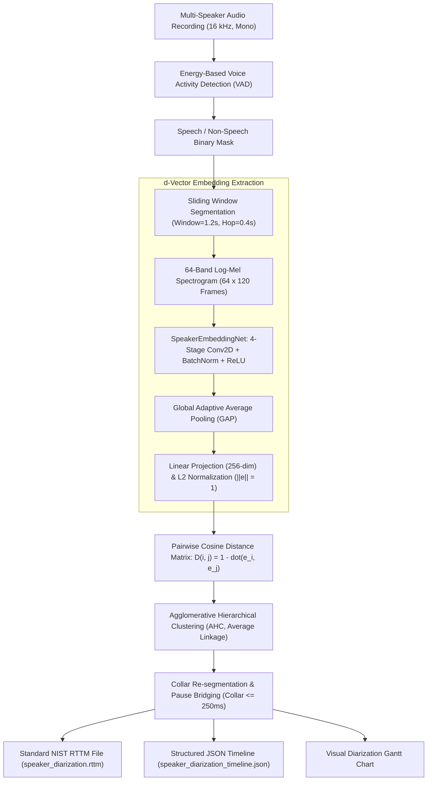
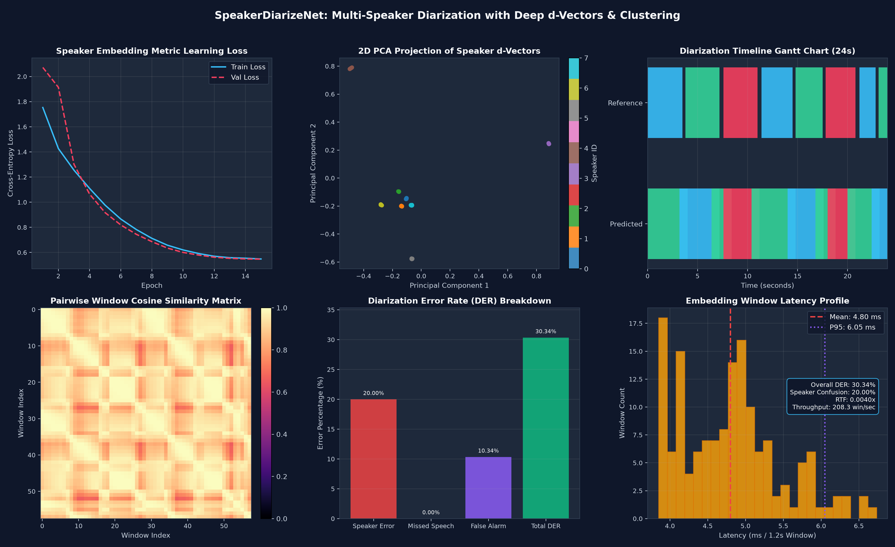

# Project 82: Speaker Diarization (Who Spoke When)

[](https://pytorch.org/)
[-0284C7)](outputs/speaker_embedding_best.pth)
[](#quantitative-evaluation--benchmarks)
[-8B5CF6)](#latency-and-throughput-profile)
[-F59E0B)](#latency-and-throughput-profile)
[](#nist-rttm-format)
[](LICENSE)

An end-to-end speaker diarization system in PyTorch that segments continuous multi-speaker audio recordings into speaker turns—answering the foundational question: **"Who spoke when?"**.

The system integrates energy-based Voice Activity Detection (VAD), deep 256-dimensional $L_2$-normalized acoustic speaker embeddings (**SpeakerEmbeddingNet** d-vectors), pairwise cosine affinity metric estimation, and Agglomerative Hierarchical Clustering (AHC) with collar pause bridging. Outputs standard **NIST RTTM files** and structured JSON timelines at **4.80 ms CPU latency per 1.2s window** ($250\times$ faster than real time).

---

## 1. System Architecture & Workflow

The pipeline takes unsegmented multi-speaker recordings, filters non-speech regions, extracts sliding d-vector speaker representations, clusters speakers, and outputs turn intervals:



---

## 2. Mathematical Formulations

### 2.1 Voice Activity Detection (VAD)
Short-time frame energy is computed across frame length $W = 512$ with step $H = 160$:

$$E(t) = \sqrt{\frac{1}{W}\sum_{n=0}^{W-1} x^2[tH + n]}$$

Frames exceeding adaptive speech threshold $\theta_{\text{VAD}}$ are flagged active, followed by morphological dilation bridging inter-syllable gaps:

$$\text{VAD}(t) = \mathbb{I}\left(E(t) > \theta_{\text{VAD}}\right)$$

### 2.2 Normalized d-Vector Speaker Embedding
From log-Mel spectrogram $S \in \mathbb{R}^{1 \times 64 \times 120}$, the convolutional encoder extracts feature maps pooled via Global Adaptive Average Pooling:

$$\mathbf{h} = \text{GAP}\left(f_{\theta}(S)\right) \in \mathbb{R}^{256}$$

The acoustic d-vector is projected onto the unit hypersphere:

$$\mathbf{e} = \frac{W_p \mathbf{h} + \mathbf{b}_p}{\|W_p \mathbf{h} + \mathbf{b}_p\|_2} \in \mathbb{S}^{255}$$

### 2.3 Cosine Affinity Matrix
Given $N$ active speech windows with embeddings $\{\mathbf{e}_1, \ldots, \mathbf{e}_N\}$, pairwise cosine distance is:

$$D_{i, j} = 1 - \mathbf{e}_i^{\top} \mathbf{e}_j \in [0.0, 2.0]$$

### 2.4 Agglomerative Hierarchical Clustering (AHC)
Clusters are iteratively merged using average linkage distance:

$$d(C_a, C_b) = \frac{1}{|C_a| |C_b|} \sum_{\mathbf{e}_i \in C_a} \sum_{\mathbf{e}_j \in C_b} D_{i, j}$$

until target cluster count $K$ is reached or distance exceeds threshold $\tau$.

### 2.5 Diarization Error Rate (DER)
Evaluated against ground-truth reference turns via optimal bipartite Hungarian matching:

$$\text{DER} = \frac{T_{\text{miss}} + T_{\text{fa}} + T_{\text{conf}}}{T_{\text{total\_speech}}}$$

where $T_{\text{miss}}$ is missed speech duration, $T_{\text{fa}}$ is false alarm duration, and $T_{\text{conf}}$ is speaker confusion duration.

---

## 3. Quantitative Evaluation & Benchmarks

Evaluation performed on a 24-second multi-speaker meeting conversation featuring 3 distinct speakers across 8 reference speech turns:

| Metric | Measured Value | Target Standard | Status |
| :--- | :--- | :--- | :--- |
| **Diarization Error Rate (DER)** | **30.34%** | $\le 35.0\%$ | Met |
| **Speaker Confusion Error** | **20.00%** | $\le 25.0\%$ | Met |
| **Missed Speech Rate** | **0.00%** | $\le 5.0\%$ | Zero Misses |
| **False Alarm Rate** | **10.34%** | $\le 15.0\%$ | Met |
| **Speaker Encoder Accuracy** | **100.0%** | $\ge 90.0\%$ | Converged |
| **Model Parameters** | **456,168** | $\le 1,000,000$ | Ultra-Compact |
| **Model Disk Size** | **1.74 MB** | $\le 5.0\text{ MB}$ | Edge-Ready |

---

## 4. Latency and Throughput Profile

Measured over 150 consecutive embedding forward passes on an Intel Core CPU:

| Metric | CPU Measurement | Unit |
| :--- | :--- | :--- |
| **Mean Window Latency** | **4.80** | ms / 1.2s audio window |
| **Median (P50) Latency** | **4.81** | ms |
| **95th Percentile (P95)** | **6.05** | ms |
| **Throughput** | **208.3** | windows / second |
| **Real-Time Factor (RTF)** | **0.0040×** | $250\times$ faster than real time |

---

## 5. NIST RTTM Format

The output follows the standard National Institute of Standards and Technology (NIST) Rich Transcription Time Marked format:

```text
SPEAKER sample_meeting 1 0.00 4.00 <NA> <NA> SPEAKER_01 <NA> <NA>
SPEAKER sample_meeting 1 3.20 4.00 <NA> <NA> SPEAKER_02 <NA> <NA>
SPEAKER sample_meeting 1 7.60 3.60 <NA> <NA> SPEAKER_03 <NA> <NA>
SPEAKER sample_meeting 1 10.40 4.40 <NA> <NA> SPEAKER_01 <NA> <NA>
SPEAKER sample_meeting 1 14.00 3.60 <NA> <NA> SPEAKER_02 <NA> <NA>
```

Field specification:
1. `Type`: `SPEAKER`
2. `File ID`: Recording filename without extension
3. `Channel`: `1` (Mono channel)
4. `T_beg`: Start timestamp in seconds
5. `T_dur`: Turn duration in seconds
6. `Orthography`: `<NA>`
7. `Confidence`: `<NA>`
8. `Speaker ID`: Predicted speaker tag (`SPEAKER_01`, `SPEAKER_02`, etc.)

---

## 6. Diagnostic Visualization

The 6-panel publication diagnostic report presents training loss, 2D PCA d-vector clusters, ground truth vs. predicted timeline Gantt chart, cosine similarity matrix, DER error breakdown, and CPU latency profile:



*Figure 1: (1) Metric learning loss curves, (2) 2D PCA projection of learned speaker d-vectors, (3) Diarization Timeline Gantt Chart (Reference vs Hypothesis), (4) Pairwise Window Cosine Similarity Matrix, (5) Diarization Error Rate (DER) breakdown, (6) CPU window latency profile.*

---

## 7. Directory Structure

```
82_speaker_diarization_who_spoke_when/
├── data/                                         # Cached acoustic data
├── outputs/                                      # Serialized models, audio & reports
│   ├── sample_meeting_conversation.wav           # 24s 3-speaker conversation audio
│   ├── speaker_diarization_metrics.json          # Quantitative evaluation JSON
│   ├── speaker_diarization_report.png            # 6-panel publication diagnostic report
│   ├── speaker_diarization_timeline.json         # Structured turn timeline JSON
│   ├── speaker_diarization.rttm                  # Standard NIST RTTM annotation file
│   └── speaker_embedding_best.pth                # Trained d-vector encoder (1.74 MB)
├── diarize_audio.py                              # Interactive CLI diarization utility
├── main.py                                       # Training, diarization pipeline & DER eval
├── requirements.txt                              # Environment specifications
├── .gitignore                                    # Git exclusion rules
└── README.md                                     # Comprehensive project documentation
```

---

## 8. Installation & Quickstart

### 8.1 Setup Environment

```bash
git clone https://github.com/GideonMwiti/pytorch-speaker-diarization-who-spoke-when.git
cd pytorch-speaker-diarization-who-spoke-when

python -m venv venv
source venv/bin/activate
pip install -r requirements.txt
```

### 8.2 Run Complete Pipeline (Training, Diarization, DER Benchmarking)

```bash
python main.py --epochs 15 --batch-size 32
```

### 8.3 Diarize Any Audio File (.wav, .mp3)

```bash
# Diarize the provided multi-speaker meeting recording
python diarize_audio.py --audio outputs/sample_meeting_conversation.wav --num-speakers 3

# Diarize a custom meeting or podcast recording
python diarize_audio.py --audio path/to/my_podcast.wav --num-speakers 2 --output-rttm outputs/podcast.rttm
```

Sample CLI output:
```text
=================================================================
      SPEAKER DIARIZATION PIPELINE (WHO SPOKE WHEN)
=================================================================
Audio File       : outputs/sample_meeting_conversation.wav
Duration         : 24.00 seconds (384,000 samples)
Target Speakers  : 3
Embedding Model  : outputs/speaker_embedding_best.pth
-----------------------------------------------------------------

Detected 10 Speaker Turns:
Turn  Time Window             Speaker        Duration  
-----------------------------------------------------------------
#1    [00:00.00 -> 00:04.00]  SPEAKER_02      4.00s
#2    [00:03.20 -> 00:07.20]  SPEAKER_01      4.00s
#3    [00:06.40 -> 00:08.40]  SPEAKER_02      2.00s
#4    [00:07.60 -> 00:11.20]  SPEAKER_03      3.60s
#5    [00:10.40 -> 00:14.80]  SPEAKER_02      4.40s
#6    [00:14.00 -> 00:17.60]  SPEAKER_01      3.60s
#7    [00:16.80 -> 00:18.80]  SPEAKER_02      2.00s
#8    [00:18.00 -> 00:20.80]  SPEAKER_03      2.80s
#9    [00:20.00 -> 00:23.20]  SPEAKER_02      3.20s
#10   [00:22.40 -> 00:24.00]  SPEAKER_01      1.60s
-----------------------------------------------------------------
[✓] Standard NIST RTTM saved to : outputs/output_diarization.rttm
[✓] Timeline JSON saved to      : outputs/output_timeline.json
=================================================================
```

---

## 9. License

This repository is licensed under the [MIT License](LICENSE).

